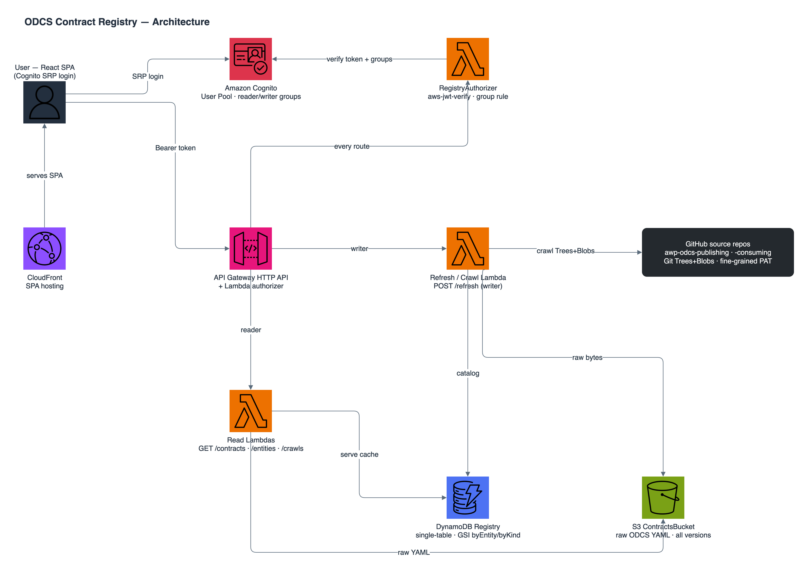
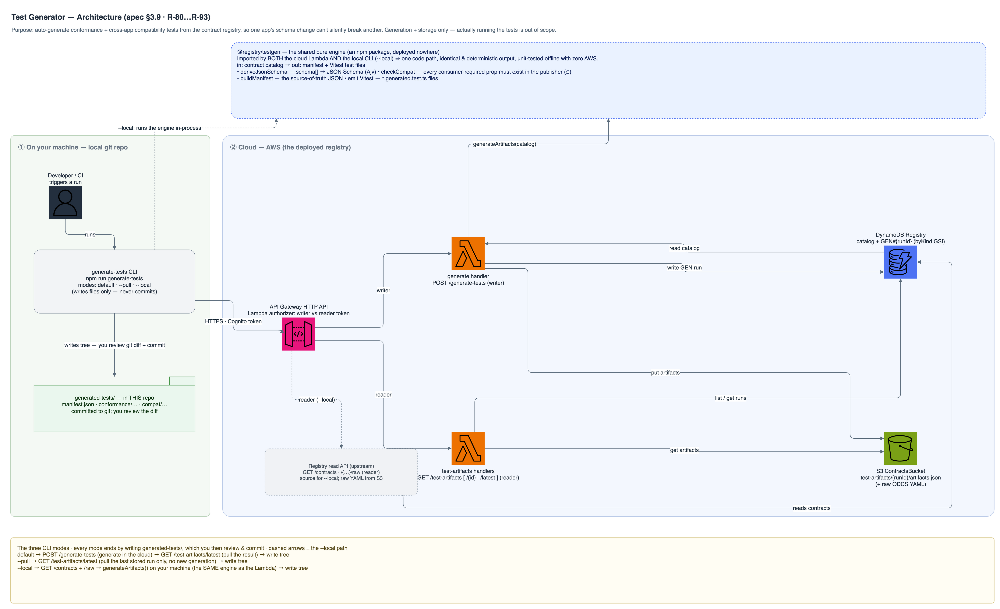
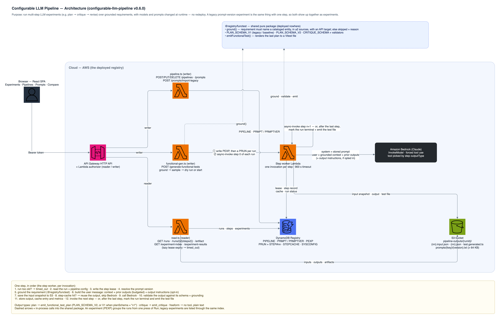

# ODCS Contract Registry

A reference AWS application that **discovers, validates, catalogs, and serves Open Data Contract Standard (ODCS v3.1.0) data contracts** by crawling two sibling repositories on demand — [`awp-odcs-publishing`](https://github.com/collegeboard-personal/awp-odcs-publishing) (publisher) and [`awp-odcs-consuming`](https://github.com/collegeboard-personal/awp-odcs-consuming) (consumer) — via the GitHub API.

Each repo carries its own copy of four OneRoster v1.2 contracts (`org`, `user`, `class`, `enrollment`); the copies have **diverged**. The registry catalogs **both variants as-is** and makes that divergence visible and queryable. Built with **Spec-Driven Development** — see [`specs/`](specs/README.md) for the full SDD structure. New to the workflow? Open [`docs/sdd-start-feature.html`](docs/sdd-start-feature.html) for a visual walkthrough of `/start-feature`. Core spec: [`specs/active/odcs-contract-registry/requirements.md`](specs/active/odcs-contract-registry/requirements.md) (the oracle).

## Architecture

A single-region, single-account **SST v2** app: an API-Gateway **HTTP API** + **Lambdas** over a **DynamoDB** single-table and an **S3** bucket, fronted by a **React SPA** on CloudFront and gated by **Cognito**. All application and infrastructure code is TypeScript.

**Data flow (trigger-then-cache).** A `writer` calls `POST /refresh`; the crawl reads each source repo's default branch via the GitHub **Trees/Blobs API** and, per source:
1. discovers `contract/*.odcs.yaml`, validates each against the vendored **ODCS v3.1.0** JSON schema, and catalogs it with **append-only version history** (keyed on the git blob SHA); and
2. reads `docs/spec.md`, extracts its **EARS requirements**, and stores them as a per-source **latest snapshot**.

Metadata lands in DynamoDB, raw bytes in S3. Reads (`GET /contracts`, `/entities`, `/requirements`, `/crawls`) serve that **pre-crawled cache** — never a live GitHub call. A separate writer path, `POST /generate-tests`, turns the catalog into stored contract-driven **end-to-end test artifacts** (generation + storage only).

**Four SST stacks**, chained so cross-stack references resolve:

| Stack | Provisions |
|-------|-----------|
| **Storage** | DynamoDB `Registry` single-table (GSIs `byEntity`, `byKind`) + `Contracts` S3 bucket |
| **Auth** | Cognito user pool, `reader`/`writer` groups, seeded `reader@demo` / `writer@demo`, `GITHUB_TOKEN` + demo-password secrets |
| **Api** | HTTP API + Lambda **REQUEST authorizer** (group-based) + crawl / read / generate handlers |
| **Web** | React SPA `StaticSite` (CloudFront) |





> Editable sources: [`docs/diagrams/*.drawio`](docs/diagrams) (draw.io / AWS symbols). Regenerate the PNGs with `node docs/diagrams/build-diagrams.mjs` then `drawio --export`. The authoritative, always-current description is [`specs/active/odcs-contract-registry/design.md`](specs/active/odcs-contract-registry/design.md).

## Design highlights

- **Crawl → cache**: `POST /refresh` crawls both repos and stores the catalog (contracts **and** each repo's EARS requirements); reads serve the cache (fast, no live GitHub calls).
- **Catalog both variants**: keyed on `{source, id}`; the identical `org` reads `divergent: false`, the diverged `user`/`class`/`enrollment` read `divergent: true` with a **semantic per-property diff**.
- **Requirements catalog**: the same crawl parses each source's `docs/spec.md` **EARS requirements** (id, text, section, EARS type, modality), catalogs them per source (latest snapshot + `changedInLastCrawl` flag), and serves them via `GET /requirements*` and a SPA Requirements view.
- **Content hash = git blob SHA** — the change signal and the cross-repo divergence check, free from the Trees API.
- **Append-only version history** keyed on content hash; a content change that reuses the declared `version` is flagged `versionNotBumped`. (Requirements, by contrast, are latest-snapshot only — see below.)
- **Storage split**: DynamoDB holds queryable metadata (catalog entries, versions, crawl/generation runs, requirements, the single-flight lock); S3 holds raw bytes (every contract version + each source's latest `docs/spec.md`).
- **Fault-isolating crawl**: one unreachable source, malformed file, or invalid contract never aborts the rest and never partially corrupts the catalog; a requirements parse/fetch/store failure is isolated from that source's cataloged contracts.
- **Test generator**: the catalog can be turned into contract-driven end-to-end tests (conformance + cross-app compatibility) via `POST /generate-tests` / the `generate-tests` CLI — generation + storage only (see below).
- **Auth**: Cognito native login; a Lambda authorizer enforces `reader`/`writer` groups at the edge (401 = no credential, 403 = credential rejected).

## Repository layout

The registry owns **no** contracts of its own — it validates and catalogs crawled ones.

```
docs/                 spec (oracle), design, acceptance-criteria, tasks, compliance, diagrams/
packages/core/        pure logic, no AWS — the shared rules:
                        github.ts        GitHub Trees/Blobs crawl (contracts + docs/spec.md ref)
                        odcs-validator.ts  ODCS v3.1.0 validation (vendored meta-schema, Ajv)
                        metadata.ts      catalog metadata + entity-name resolution
                        diff.ts + schema-model.ts  semantic per-property contract diff
                        requirements.ts  EARS spec parser (docs/spec.md → requirements)
                        api-map.ts · sources.ts   source + per-entity API config
packages/testgen/     pure test-generation engine, no AWS:
                        derive-schema · compat · emit · manifest · generate
                        (catalog → { manifest, *.generated.test.ts })
packages/functions/   Lambdas:
                        authorizer.ts    Cognito group authorizer (edge)
                        refresh.ts       single-flight crawl → catalog contracts + requirements
                        read.ts          contracts / entities / requirements / crawls / test-artifacts
                        generate.ts      POST /generate-tests
                        repository.ts    DynamoDB single-table + S3 (raw bytes)
                        seed.ts · log.ts · http.ts
packages/web/         React SPA (Cognito login; browse by entity/source, contract
                        detail + diff, requirements view, writer Refresh)
stacks/               Storage · Auth · Api · Web (SST v2)
scripts/              generate-tests CLI (runs under `sst bind`)
generated-tests/      generated artifacts (manifest + *.generated.test.ts);
                        excluded from the registry's own test suites
```

## Prerequisites

- **Node 24** via Spack (declared in `spack.yaml`); `direnv` auto-activates it.
- An AWS account + credentials for deploy.
- A **fine-grained GitHub PAT** (Contents:read on the two source repos).

## Commands

```sh
npm install            # install workspaces
npm run typecheck      # tsc (backend + web) — see note below
npm run test:offline   # backend + core suite (mocked AWS + offline CFN synth) — 138 tests
npm run test:web       # SPA suite (jsdom) — 18 tests
npm run test:all       # both
npm test               # backend suite under `sst bind` (real bound values; needs AWS + a deployed stage)

# Deploy (real AWS):
npx sst secrets set GITHUB_TOKEN <fine-grained-PAT> --stage <stage>
npx sst secrets set REGISTRY_DEMO_PASSWORD <demo-password> --stage <stage>
npm run deploy         # sst deploy → provisions Storage/Auth/Api/Web + seeds reader@demo / writer@demo
```

> **Typecheck needs SST's generated binding types.** Handlers read resources
> through `sst/node` (`Table`, `Bucket`, `Config`), whose typed accessors are
> declared in `.sst/types/**` — generated by SST and referenced from
> `tsconfig.json`. Because `.sst/` is gitignored, a **fresh clone must generate
> those types before `npm run typecheck`** (e.g. run `npm run deploy`, or
> `npx sst build`, once). `npm run test:offline` does **not** need them or AWS —
> `vitest.setup.ts` stubs the SST resource-binding env vars with inline local
> values; `npm test` (`sst bind vitest run`) exercises the real bound values
> against the deployed stage instead.

## API

| Method | Path | Group | Purpose |
|--------|------|-------|---------|
| POST | `/refresh` | writer | Crawl both repos and update the catalog |
| GET | `/contracts?source=&entity=&validation=` | reader | List cataloged contracts |
| GET | `/contracts/{source}/{id}` | reader | Entry metadata + version history |
| GET | `/contracts/{source}/{id}/raw?version=` | reader | Raw ODCS YAML |
| GET | `/entities/{entity}` | reader | Variants + `divergent` + semantic diff |
| GET | `/requirements?source=&earsType=&conforming=` | reader | List cataloged EARS requirements |
| GET | `/requirements/{source}` | reader | A source's requirement set + spec version/hash |
| GET | `/requirements/{source}/{id}` | reader | Single requirement detail |
| GET | `/crawls` · `/crawls/{runId}` | reader | Crawl-run history |
| POST | `/generate-tests` | writer | Generate E2E tests from the catalog; store the artifact set |
| GET | `/test-artifacts` · `/test-artifacts/{runId\|latest}` | reader | Generation-run history + inline artifact set |

## Requirements Catalog

Beside the ODCS contracts, the registry crawls each source repo's own **EARS requirements** (`docs/spec.md`) in the **same `POST /refresh`** pass, parses each `- **R-nn** — …` bullet into `{ id, text, section, earsType (event/unwanted/state/optional/ubiquitous), modality (SHALL/SHOULD/MAY), earsConforming }`, and catalogs them **per source** — **latest snapshot** with a `changedInLastCrawl` flag (no version history, deliberately unlike contracts). Requirements without a modality keyword are flagged non-conforming but still cataloged. Served via `GET /requirements*` and a **Requirements** view in the SPA (a third toggle beside By entity / By source), grouped by section with non-conforming and changed requirements badged. Requirements are cataloged **independently per source** — the registry does not diff requirements across apps (unlike contracts). See [`specs/active/odcs-contract-registry/requirements.md`](specs/active/odcs-contract-registry/requirements.md) §3.10 (R-100…R-114) and [`specs/active/odcs-contract-registry/design.md`](specs/active/odcs-contract-registry/design.md) §10.

## Test Generator (contract-driven E2E tests)

Turns the discovered catalog into runnable end-to-end tests — **generation + storage only**; running them on demand is future work. A generation run emits a JSON **manifest** (source of truth) plus **Vitest `*.generated.test.ts`** for two kinds:

- **Live API-conformance** — fetch each entity's records from the owning app's deployed API (Cognito token via env) and validate every record against a JSON Schema derived from the contract's `schema[]`. Skips (never fails) when live creds are absent.
- **Cross-app compatibility** — consumer-can-read-publisher: every property the consumer's contract requires must be present and type-compatible in the publisher's.

Invalid / single-source / unmapped contracts are **skipped with a recorded reason**. Produced by the writer-authed `POST /generate-tests` endpoint (artifacts → S3/DDB) and landed in `generated-tests/` by the CLI:

```sh
# default: auth as writer → generate → pull latest → write generated-tests/
npm run generate-tests              # = `sst bind tsx scripts/generate-tests.ts`
npm run generate-tests -- --pull    # write the latest existing run only
npm run generate-tests -- --local   # generate offline from GET /contracts
```

You supply **nothing but AWS credentials** (`AWS_PROFILE`/`--stage`). `sst bind` injects the stage's SSM-backed bindings, so the CLI reads the API URL from the Api resource binding (`sst/node/api`), the client id from `Config.Parameter USER_POOL_CLIENT_ID`, and the writer password from the existing `Config.Secret REGISTRY_DEMO_PASSWORD` (the seeded writer@demo password), authenticating as `writer@demo` automatically — no config file, no `.env`, no prompt (D-35). Environment variables override any value for CI or ad-hoc use: `REGISTRY_TOKEN` (skip login), `REGISTRY_USERNAME`/`REGISTRY_PASSWORD`, `AWS_REGION`. A missing API URL or credential fails fast with a directive error rather than hanging.

The CLI writes files only — review `git diff` and commit. `generated-tests/**` is excluded from the registry's own test suites. See [`specs/active/odcs-contract-registry/requirements.md`](specs/active/odcs-contract-registry/requirements.md) §3.9 (R-80…R-93, R-91a) and [`specs/active/odcs-contract-registry/design.md`](specs/active/odcs-contract-registry/design.md) §9.

**Running the generated tests is out of scope** (spec §2, D-29). The generator *generates and stores* the tests; executing them — on demand, on a schedule, or in CI — is a separate future feature. The per-entity env-var names each conformance test reads live in `packages/core/src/api-map.ts` (echoed in `generated-tests/manifest.json`); today only `publisher/org` (`GET /orgs`) and `consumer/class` (`GET /me/classes`) are mapped, so those are the only conformance tests emitted.

## LLM Functional Test Generator (spec v0.6.0 §3.11)

> **✅ Implemented (offline-green); deploy pending.** Code in `packages/functest` + `packages/functions/{llm,functional-gen}.ts`; specified in [`specs/active/odcs-contract-registry/requirements.md`](specs/active/odcs-contract-registry/requirements.md) §3.11 (R-115…R-126, D-50…D-56) and [`specs/active/odcs-contract-registry/design.md`](specs/active/odcs-contract-registry/design.md) §11. Deploy needs Bedrock model access enabled in-region; running the emitted tests stays out of scope (D-56).

A planned component that turns the cataloged **ODCS contracts** *and* **EARS requirements** into **end-to-end cross-service functional tests** (publisher → CDC → consumer). Because a functional scenario lives in each service's natural-language EARS prose (which the registry doesn't control — D-3), an **LLM** (Claude on **Amazon Bedrock** via `@aws-sdk/client-bedrock-runtime` `InvokeModel`; IAM-role auth, no stored key — D-55; default **Sonnet 4.6**) synthesises a **structured test-plan** — grounded in the contract `schema[]` + the requirement + the api-map, constrained by forced tool use — which the deterministic emit layer renders to Vitest. The plan is **cached by input-hash** and committed, so re-runs are stable despite LLM nondeterminism (R-88 is scoped out of the synthesis step). It runs **asynchronously** (`POST /generate-functional-tests` → job; `GET /functional-test-jobs/*`; CLI `--functional` delivers artifacts for human review) and is **generate-and-store only** (D-56 — running stays future work).

## Experiments — Configurable LLM Pipelines (spec v0.6.0)

> **✅ Implemented (offline-green).** Code in `packages/core/src/pipeline.ts`, `packages/functions/src/pipeline.ts`, `packages/web/src/pages/{ExperimentsHubPage,PipelinesPage,PromptsPage,ComparePage}.tsx`. Spec: [`specs/active/configurable-llm-pipeline/requirements.md`](specs/active/configurable-llm-pipeline/requirements.md) v0.6.0.

Alongside the single-step generator above (which the CLI and `POST /generate-functional-tests` without a `pipelineId` still use, unchanged), the registry has a **runtime-configurable pipeline** system — stored in DynamoDB, changeable without redeploy — that chains LLM steps (e.g. generate → critique → revise) with per-step models, prompts, and output types. A legacy prompt-version experiment is just a one-step pipeline run over every groundable requirement, so both appear together as **experiments** in the SPA. Each step's output is cached by SHA-256 hash of `{inputHash, pipelineId, configVersion, stepId, promptKey, promptVersion}` (plus the output-instructions version when that is on), so changed inputs or config re-synthesize while unchanged inputs → cache hit → no LLM call.


### Key features

- **Pipeline configuration** — stored in DynamoDB as `PIPELINE` items: ordered steps (each with `label`, `model`, `promptKey`, `outputType`, `optional`), `maxSteps`, `maxAgeMinutes`, sampling defaults
- **Prompt versioning** — prompts stored as `PRMPT` items with immutable `PRMPTVER` history; updating a prompt creates a new version and invalidates step cache keys
- **Async Lambda chain execution** — step worker Lambda invokes itself with `InvocationType: 'Event'`; lease-based timeout detection, no SQS/Step Functions
- **Step output types** — `plan` (v1 legacy or v2 extended), `critique` (structured review), `freeform` (no schema)
- **Sampling strategies** — `first_n`, `percentage` (deterministic hash-based), `ids`, `all`; applies to grounded requirements only
- **Execution modes** — `per_requirement` (N independent runs) or `batch` (one run with M requirements — note: batch mode grounds only the first requirement in v0.6.0, a known limitation Q4)
- **Opt-in output instructions** — off by default so baseline steps get exactly the original input; when on, the runtime appends field-by-field guidance for the step's output type to the model input
- **Step transparency** — every step's exact model input (system prompt, user message sections, tool) is saved to S3; the run page shows Output / Input / Changes / Raw / Metrics per step
- **Generated test per run** — when a run completes, its last plan step is rendered to a Vitest file (`GET /runs/{runId}/artifact`)
- **Unified experiments view** — one press of Run is one experiment (dry run first, confirmation above 20 requirements); SPA lists pipeline and legacy experiments together and compares any two requirement by requirement
- **Baseline pipeline** — seeded `baseline-legacy-v1` pipeline reproduces the legacy generator's request exactly (plan v1, same prompt, same model) for reproducibility

### SPA pages

- **Prompts** (`/prompts`) — list + version history + editor; import legacy prompt versions (one-way idempotent)
- **Pipelines** (`/pipelines`) — list + editor with resizable split pane, step add/remove/reorder, prompt body preview
- **Experiments** (`/experiments`) — hub with dry-run + confirmation (>20 selected), run history, skipped requirements display
- **Compare** (`/compare`) — experiment-level: per-requirement table with plan side-by-side, field diff, test-file line diff

### Grounding

A requirement is **grounded** if it mentions a cataloged entity name (whole-word, case-insensitive, optional plural), that entity exists in ≥2 sources, and the entity has an API target in `api-map.ts`. Ungroundable requirements (infra-only, single-service, unmapped) are returned as `skipped` with a reason. Grounding is literal name-matching; semantic similarity is out of scope.

### ⚠️ Past legacy experiment results

Before commit `dbd78bb`, the legacy experiment runner dropped the selected prompt version's text and always used the built-in **v1** prompt (only the version's model setting took effect). Legacy experiment results for any prompt version other than `v1` therefore **do not reflect that prompt** — don't read them as prompt comparisons. `v1` results are unaffected.

### What's out of scope (follow-ons)

- **DAG / parallel steps** — linear chain only; `dependsOn` reserved in schema
- **Multi-requirement grounding in batch mode** — Q4 open; batch mode grounds only `requirementIds[0]`
- **Human review gates** — `waitForHuman: true` reserved but treated as no-op
- **Running the generated tests** — generate-and-store only
