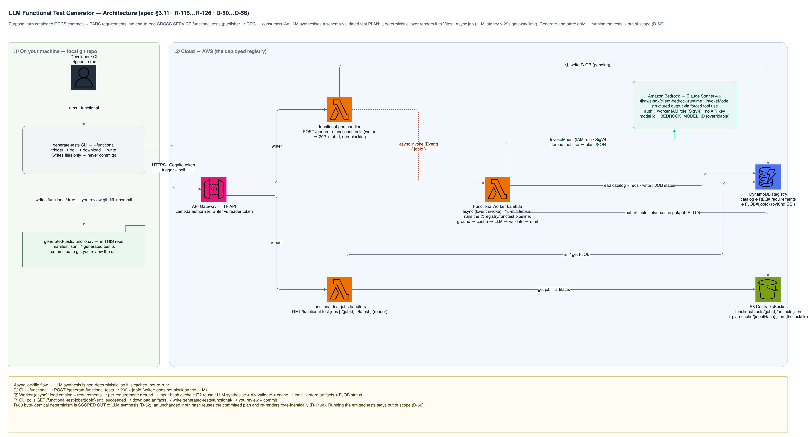

# ODCS Contract Registry — Technical Design

> **Phase 2 — Plan.** Derived from `docs/spec.md` (the oracle, v0.6.0) and `docs/acceptance-criteria.md`. This says *how*; the spec says *what*. Changes here are cheap; changes after implementation are not. Review the checklist at the end (§8) before approval.
>
> **§1–§8 describe the registry core** (spec R-01…R-72). **§9 describes the Test Generator component** (spec R-80…R-93, D-23…D-34), added at spec v0.4.0. **§10 describes the Requirements Catalog component** (spec R-100…R-114, D-44…D-48), added at spec v0.5.0. **§11 describes the LLM Functional Test Generator component** (spec R-115…R-126, D-50…D-56), added at spec v0.6.0 — **implemented 2026-07-16 (T-33…T-39)**. All reuse the core's parse/validate/property-model and the existing single-table + S3 + HTTP-API + authorizer patterns; the Test Generator's net-new surface is one pure package (`@registry/testgen`), two endpoints, a generation-run item kind, an S3 artifact prefix, and a CLI; the Requirements Catalog's is one pure parser (`requirements.ts`), a `REQ#` item kind, three read endpoints, and a SPA view; the Functional Generator's is a pure plan-synthesis package + an injectable `LlmClient` (Bedrock SDK), a `FJOB#` item kind, an async job + two routes, and a CLI mode.
>
> **Reuse note.** This app is a sibling of `odcs-example-publishing-app` and `odcs-example-consuming-app` and deliberately mirrors their conventions: TypeScript npm-workspaces monorepo, SST v2 (CDK) stacks with `StackContext` + `use()`, DynamoDB on-demand + SSE, API Gateway HTTP API + Cognito **user_pool** JWT authorizer, Ajv (`Ajv2019` + `ajv-formats`) + `js-yaml` for ODCS validation, Vitest offline CFN-synth assertions + jsdom SPA tests. Three capabilities are **net-new** (no prior pattern in either app) and are flagged in §7: Cognito **groups**, SST **Secrets** (`Config.Secret`), and **deploy-time user/group seeding**.

---

## 1. Architecture Overview


> Editable source: [`diagrams/registry-architecture.drawio`](diagrams/registry-architecture.drawio) (draw.io / AWS symbols). Crawl detail: the Refresh Lambda acquires a DynamoDB single-flight lock (D-15), then per source runs Trees+Blobs → parse → validate (Ajv) → extract → catalog, and writes the run summary before unlocking. The GitHub PAT lives in SST Secret `GITHUB_TOKEN`. Storage: DynamoDB single-table (entries · versions · crawl-runs · lock; GSI byEntity/byKind; SSE) + S3 ContractsBucket (raw ODCS YAML per version; block-public; SSE).

### Components & responsibilities

| Component | Responsibility | Key requirements |
|-----------|----------------|------------------|
| **Web SPA** (React + Vite, SST `StaticSite`) | Native Cognito login (SRP); browse catalog with a **by-entity / by-source toggle** (`groupByEntity` / `groupBySource` in `lib.ts`); contract detail + YAML + history; per-property diff; writer-only Refresh | R-60…R-65 |
| **Cognito User Pool** (SST `Cognito`) | Native username+password IdP; self-signup **off**; `reader`/`writer` groups; issues access tokens | R-56, R-60, R-70, R-71 |
| **User/group seed** (SST `Script`, deploy-time) | Create `reader` + `writer` demo users, assign groups (idempotent) | R-72 |
| **RegistryAuthorizer** (SST `Api` **lambda** authorizer, `packages/functions`) | Verify Cognito access token (`aws-jwt-verify`); read `cognito:groups` + `routeKey`; require `writer` for `POST /refresh`, `reader\|writer` otherwise; Allow/Deny at the edge (D-21) | R-16, R-56, R-71 |
| **API** (SST `Api`, HTTP API + lambda authorizer + Lambdas) | AuthN/authZ gate via the authorizer; read endpoints; refresh trigger | R-10, R-50…R-56 |
| **Refresh/Crawl Lambda** (`packages/functions`) | Single-flight crawl of all sources, ingest, catalog, run summary | R-10…R-15, R-30…R-34 |
| **GitHub source client** (`packages/core`) | Fine-grained PAT auth; Git Trees (recursive) + Blobs; select `contract/*.odcs.yaml` | R-01…R-03, R-10, R-11, D-14 |
| **ODCS validator** (`packages/core`, `Ajv2019` + `ajv-formats` + `js-yaml`) | Parse YAML; validate against vendored `odcs-v3.1.0.schema.json`; structured failures | R-20, R-21 |
| **Metadata extractor** (`packages/core`) | id/name/version/entity(=`schema[0].name`↦filename) etc. | R-22, D-12 |
| **Semantic differ** (`packages/core`) | Per-property added/removed/changed between two parsed contracts | R-53, D-18 |
| **Catalog repository** (`packages/functions`) | DynamoDB single-table reads/writes; version logic; lock; collision flag | R-30…R-34, R-40, D-13, D-15 |
| **Blob store** (folded into the Catalog repository — no separate module) | S3 put/get/delete of raw contract YAML per version and the latest raw `docs/spec.md` per source | R-41, R-42, R-114 |
| **DynamoDB `Registry`** (SST `Table`) | entries · versions · crawl-runs · lock; GSI `byEntity`, `byKind`; SSE | R-40, R-42 |
| **S3 `ContractsBucket`** (SST `Bucket`) | Raw ODCS bytes, all versions; SSE; block public access | R-41, R-42 |
| **GITHUB_TOKEN** (SST `Config.Secret`) | Fine-grained PAT, bound only to the crawl Lambda; never logged/returned | R-02, NFR-2 |

---

## 2. Data Models

### 2.1 DynamoDB `Registry` — single-table design

On-demand, SSE (`TableEncryption.AWS_MANAGED`), mirroring the apps' `Table` idiom. One table holds four item kinds, distinguished by key shape:

| Item kind | PK | SK | Notable attributes |
|-----------|----|----|--------------------|
| **Catalog entry** (current state of a `{source,id}`) | `SRC#{source}` | `CON#{id}` | `entity`, `name`, `filePath`, `currentVersion` (int), `currentHash` (git blob SHA), `declaredVersion`, `validation` (`valid`/`invalid`), `validationErrors?`, `commitSha`, `lastCrawledAt`, GSI keys below |
| **Version** (immutable history row) | `VER#{source}#{id}` | `V#{000n}` (zero-padded) | `versionNumber`, `hash`, `declaredVersion`, `versionNotBumped` (bool), `commitSha`, `crawledAt`, `validation`, `s3Key` |
| **Crawl run** | `RUN#{runId}` | `RUN` | `startedAt`, `endedAt`, `sources[]` {label, outcome, counts}, `collisions[]`, GSI keys below |
| **Lock** (single-flight, D-15) | `LOCK` | `CRAWL` | `runId`, `acquiredAt`, `ttl` (epoch; DynamoDB TTL attribute) |
| **Requirement** (current snapshot of a `{source, R-id}`, §10 · R-106) | `REQ#{source}` | `R#{id}` | `text`, `earsType` (event/unwanted/state/optional/ubiquitous), `modality` (SHALL/SHOULD/MAY/`null`), `section`, `earsConforming` (bool), `changedInLastCrawl` (bool), `specHash` (blob SHA of `docs/spec.md`), `specVersion?`, `lastCrawledAt` |

> The **generation-run** item kind (`GEN#{runId}/GEN`, `kind:"GENERATION"`) is defined in §9.3. Requirement items are **latest-snapshot only** — deliberately no `REQVER#` history rows (D-45), unlike contracts.

**GSIs**
- **`byEntity`** — PK `entity`, SK `source` (the raw label). Only *catalog-entry* items populate `entity`, so this index returns exactly the current variants of an entity (backs `GET /entities/{entity}`, R-53). The query is source-ascending, so `read.ts` re-orders variants **publisher-first** before diffing so the diff's A/B is deterministic (see §2.3). Projection: ALL.
- **`byKind`** — PK `kind` (`"CRAWL"` on crawl-run items, `"GENERATION"` on generation-run items — disjoint, so the two listings never intersect), SK `startedAt`. Backs `GET /crawls` (R-55) and `GET /test-artifacts` (R-90) newest-first. Projection: ALL.

**Key choices**
- Catalog key is **`{source, id}`** (D-13); a same-`id` collision within one source is detected before write and appended to the run's `collisions[]` (R-30a) rather than overwriting.
- **Content hash = the GitHub git blob SHA** returned by the Trees API. It is a stable SHA-1 over the file content, so identical files across repos share a hash (drives `divergent:false` for `org`, E-5) and any content change flips it (R-32/R-33) with no extra hashing step.
- **Versioning**: on ingest, compare fresh hash to the entry's `currentHash`. Equal → unchanged (bump `lastCrawledAt`/`commitSha` only, R-32). Different (or new entry) → append a `Version` row, bump `currentVersion`, set `versionNotBumped` when the declared `version` field is unchanged (R-33, R-33a, D-16). History rows are never mutated (append-only, D-10).

### 2.2 Catalog-entry shape (API projection)

```jsonc
{
  "source": "publisher",
  "id": "5d8f2b4a-org-oneroster-v12",
  "entity": "org",
  "name": "OneRoster v1.2 Org",
  "currentVersion": 1,
  "currentHash": "a1b2c3…",           // git blob SHA
  "declaredVersion": "1.0.0",
  "validation": "valid",
  "commitSha": "def456…",             // branch tip at crawl time
  "lastCrawledAt": "2026-07-08T…Z",
  "filePath": "contract/org.odcs.yaml"
}
```

### 2.3 `GET /entities/{entity}` response (semantic diff, D-18)

```jsonc
{
  "entity": "user",
  "variants": [ /* full catalog-entry items (projection ALL), one per source */ ],
  "divergent": true,                    // variants[].currentHash differ
  "diff": {                             // present only when exactly 2 variants; A = publisher, B = consumer
    "onlyInA":  [ { "path": "user.password" } ],                       // in publisher, not consumer
    "onlyInB":  [ { "path": "user.middleName" } ],                     // in consumer, not publisher
    "changed":  [ { "path": "user.email", "field": "required", "a": true, "b": false } ]
  }
}
```

`diffContracts(a, b)` (**A = publisher, B = consumer** — `read.ts` orders the variants publisher-first before calling it, independent of the byEntity GSI's source-ascending order) walks the parsed ODCS `schema[].properties` of both variants — via the shared `normalizeContractSchema` model (reused by the compat check) — and emits `onlyInA` / `onlyInB` (by dotted path) and `changed` (`{ path, field, a, b }`, where `field` is one of `required`, `logicalType`, `physicalType`, or enum `validValues`). Property order is normalised so YAML re-ordering does not register as a change (contrast with a raw text diff — D-18). The `variants` array is the raw catalog-entry projection (a superset of `{source, currentHash, currentVersion}`), returned publisher-first.

### 2.4 S3 object layout

```
s3://{ContractsBucket}/contracts/{source}/{id}/{versionNumber}-{shortHash}.odcs.yaml
s3://{ContractsBucket}/requirements/{source}/spec.md          # latest snapshot only (R-114, §10)
```
Every contract version's exact bytes are stored (R-41); the `Version` row's `s3Key` points at it. Each source's current `docs/spec.md` is stored **once** (overwritten on content change — latest-snapshot, D-45), for provenance and source-document retrieval. Bucket blocks public access and is SSE-encrypted (R-42).

### 2.5 Vendored ODCS meta-schema

`packages/core/resources/odcs-v3.1.0.schema.json` — copied verbatim from the apps' `contract/odcs-v3.1.0.schema.json`. It is the **validation oracle** for every crawled document (R-20). It is *not* a contract the registry catalogs (R-23, D-20).

---

## 3. API Surface

Base: `/` on the HTTP API. All routes go through a single **Lambda REQUEST authorizer** (`RegistryAuthorizer`, D-21) that both authenticates and authorizes at the edge. Status-code mapping: a **missing `Authorization` header → `401`** (API Gateway short-circuits before invoking the authorizer); a **present-but-rejected token — invalid, expired, or lacking the required group → `403`** (the authorizer denies). Per-route rule: `POST /refresh` requires the `writer` group; every read route requires `reader` **or** `writer`. The authorizer verifies the Cognito **access** token with `aws-jwt-verify` and inspects `event.routeKey` + the `cognito:groups` claim; on Allow it passes `{ sub, username, groups }` through to handlers via `event.requestContext.authorizer.lambda`. Authorizer result **caching is disabled** (`resultsCacheTtl: 0`) so a token allowed for a read route cannot be replayed against `POST /refresh` from cache. JSON in/out.

| Method | Path | Group | Success | Errors |
|--------|------|-------|---------|--------|
| POST | `/refresh` | writer | `200` crawl-run summary (R-12) | `401`, `403` (R-16), `409` in-flight (R-15) |
| GET | `/contracts?source=&entity=&validation=` | reader | `200` `{ items: Entry[] }` (R-50) | `401`, `403` |
| GET | `/contracts/{source}/{id}` | reader | `200` entry + version history (R-51) | `401`, `403`, `404` (R-54) |
| GET | `/contracts/{source}/{id}/raw?version=` | reader | `200` raw YAML (R-52) | `401`, `403`, `404` |
| GET | `/entities/{entity}` | reader | `200` variants + `divergent` + diff (R-53) | `401`, `403`, `404` |
| GET | `/crawls` | reader | `200` run history (R-55) | `401`, `403` |
| GET | `/crawls/{runId}` | reader | `200` single run (R-55) | `401`, `403`, `404` |
| GET | `/requirements?source=&earsType=&conforming=` | reader | `200` `{ items: Requirement[] }` (R-109) | `401`, `403` |
| GET | `/requirements/{source}` | reader | `200` source set + specVersion/specHash/lastCrawledAt (R-110) | `401`, `403`, `404` |
| GET | `/requirements/{source}/{id}` | reader | `200` single requirement (R-111) | `401`, `403`, `404` |

- **Refresh response / run summary (R-12, R-108):** `{ runId, startedAt, endedAt, sources: [{ label, outcome: "success"|"failed", discovered, valid, invalid, newVersion, unchanged, reason?, requirements?: { discovered, conforming, nonConforming, changed, removed, failed?, reason? } }], collisions: [{ source, id, paths }] }`. The `requirements` block is per-source (§10, R-108); its `failed?`/`reason?` are set only when the requirements sub-crawl was isolated-failed (R-105a).
- **Raw content type (R-52):** `application/yaml`.
- **Validation-failure surfacing:** an entry cataloged `invalid` carries `validationErrors: [{ path, keyword, message }]` (derived from Ajv errors), shown in list/detail.
- **`POST /refresh` runs the crawl synchronously** within the Lambda and returns the summary. A full two-repo crawl (~1 tree + ~5 blobs per repo) completes well under the API Gateway 29 s integration limit and the NFR-1 30 s target. §7.4 flags the async escalation path if source count grows.

---

## 4. Tech Stack & Justification vs. NFRs

| Choice | Justification |
|--------|---------------|
| **TypeScript** everywhere | NFR-7 (mandated); shared `@registry/core` types across crawler, API, differ |
| **SST v2** (CDK) | NFR-6 single-command deploy; L2 `Table`/`Bucket`/`Api`/`Cognito`/`StaticSite`/`Script`/`Config.Secret`; drop to CDK `CfnUserPoolGroup` for groups |
| **API Gateway HTTP API + Lambda** | NFR-1 low-latency reads (served from cached catalog, not live crawl — D-7); cheaper/faster than REST API |
| **DynamoDB on-demand single-table + 2 GSIs** | NFR-3 (scales to ≥10 sources × ≥25 contracts × history with no capacity planning); single-digit-ms reads for `GET /contracts` |
| **S3 for raw bytes** | R-41 exact-byte retrieval of every historical version; cheap, durable |
| **GitHub Git Trees + Blobs API** (D-14) | Exact per-file blob SHA (feeds the hash-based version model) without downloading tarballs; ~6 calls/repo ≪ rate limits |
| **`@octokit/rest`** (new dep) | Typed GitHub client: auth, tree/blob endpoints, error typing for R-13 fault isolation. *(Plain `fetch` is a viable lighter fallback — §7.5.)* |
| **`Ajv2019` + `ajv-formats` + `js-yaml`** | Exactly the apps' ODCS validation stack (versions in §4.1); reuse, not reinvent |
| **Cognito + Lambda REQUEST authorizer** (`aws-jwt-verify`) | NFR-2: authN **and** group authZ enforced at the edge (D-21); native SRP login reused from the consuming app. Chosen over the native `user_pool` JWT authorizer because that one validates tokens but cannot gate on Cognito **groups** |
| **SST `Config.Secret` for `GITHUB_TOKEN`** | NFR-2: PAT never in source/logs; bound only to the crawl Lambda |
| **Plain structured logging** (`console.log(JSON.stringify({…}))`) | NFR-5 structured per-source/per-file logs with offending path/id — matches both apps (neither uses Powertools) |

### 4.1 Dependency versions (pinned to the apps)

`ajv ^8.17.1`, `ajv-formats ^3.0.1`, `js-yaml ^4.1.0`, `sst ^2.43.7`, `aws-cdk-lib 2.224.0`, `constructs 10.3.0`, `typescript ^5.4.5`, `vitest ^1.6.0`, `react ^18.3.1`, `vite ^5.3.3`, `amazon-cognito-identity-js` (consuming-app version). **New:** `@octokit/rest` (latest v20) for the crawler; `aws-jwt-verify` (^4) for the Lambda authorizer's Cognito access-token verification. Node 24 via `spack.yaml`; `nodejs20.x` Lambda runtime + arm64 (matching the apps' `setDefaultFunctionProps`).

---

## 5. Integration Boundaries → Integration Tests

Each becomes an integration test (Phase 3 pairs these with tasks):

1. **SPA ↔ Cognito** — SRP login yields a usable access token; groups claim present (AC-60, AC-64).
2. **SPA ↔ API** — authorized reads; `401` without token; writer-only Refresh hidden for readers (AC-56, AC-64).
3. **Refresh ↔ GitHub client** — Trees+Blobs returns only `contract/*.odcs.yaml`; auth via secret (AC-03, AC-10).
4. **Crawl ↔ ODCS validator** — valid pass, bad YAML / bad schema → `invalid`, crawl continues (AC-20, AC-21a/b).
5. **Crawl ↔ catalog repo** — new/unchanged/new-version transitions; collision flag; `versionNotBumped` (AC-31, AC-32, AC-33, AC-33a, AC-30a).
6. **Crawl ↔ lock** — second refresh → `409`; stale TTL lock reclaimable (AC-15).
7. **Crawl fault isolation** — one source fails, others catalog; existing entries untouched (AC-13, AC-14).
8. **Repo ↔ DynamoDB/S3** — entry+history persisted; raw bytes round-trip from S3 incl. historical versions (AC-40, AC-41).
9. **API ↔ catalog** — filters, 404s, entity diff, crawl history (AC-50…AC-55).

---

## 6. Failure Modes

| Boundary | What can go wrong | Handling |
|----------|-------------------|----------|
| API authorizer | missing `Authorization` header | `401` at gateway before the authorizer runs (R-16, R-56) |
| API authorizer | present token invalid/expired, or wrong group | authorizer denies → `403` (R-16, R-56, R-71, D-21) |
| API authorizer | `aws-jwt-verify` throws / JWKS fetch fails | authorizer errors → `500`; no route runs |
| GitHub — source unreachable / 5xx / auth | one repo down | source `outcome: failed` + reason; other sources continue; existing entries kept (R-13, D-9) |
| GitHub — rate limit (403 + `x-ratelimit-remaining: 0`) | many crawls | source `failed` with rate-limit reason; other sources unaffected (E-16, D-15) |
| GitHub — empty `contract/` | no files | source `success`, 0 discoveries (R-14) |
| Parse/validate — bad YAML or non-ODCS | malformed contract | entry `validation: invalid` + errors; crawl continues (R-21) |
| Catalog — duplicate `id` in one source | authoring bug | first cataloged; collision recorded in run; no overwrite (R-30a) |
| Concurrency — overlapping refresh | double crawl | conditional-write lock fails → `409` + in-flight runId; TTL frees a crashed lock (R-15) |
| Crawl crash mid-run | lock never released | TTL attribute expires the lock; next refresh proceeds (D-15) |
| Read — unknown source/id/entity/version | bad path | `404` (R-54) |
| Secret — missing/invalid PAT | misconfig | crawl marks every source `failed` (auth); never logs the token (NFR-2) |

---

## 7. Spec Conflicts & Design Risks (surfaced now)

**7.1 — Group enforcement is done by a Lambda authorizer (D-21), because no built-in authorizer gates on Cognito groups.** Neither the HTTP API `user_pool` JWT authorizer nor the REST API Cognito authorizer can deny a request based on group membership — both only authenticate. **Resolution:** a single Lambda REQUEST authorizer (`RegistryAuthorizer`) verifies the access token with `aws-jwt-verify` and applies the per-route group rule (`writer` for `POST /refresh`, `reader|writer` for reads), returning Allow/Deny at the edge. The seeded writer user is placed in **both** groups so it can also read. Consequences and their handling:
- **Status codes.** Missing `Authorization` header → `401` (gateway short-circuits). Present-but-rejected token (invalid/expired/insufficient-group) → `403`. This adopts the clean `401 = no credential / 403 = credential rejected` model; the spec's R-16/R-56/E-12 were updated to match (previously expired/malformed → `401`).
- **Caching.** `resultsCacheTtl: 0` — because a per-route rule means a token Allowed for a read route must not be replay-allowed against `POST /refresh` from the authorizer cache.
- **Token verification moves into our code.** A Lambda authorizer replaces the gateway's built-in JWT validation, so the authorizer itself must verify signature/issuer/audience/expiry and assert `token_use == "access"` (via `aws-jwt-verify`'s `CognitoJwtVerifier`). This is a new component + dependency vs the sibling apps' `user_pool` authorizer.
- **Alternative considered — REST API Lambda authorizer** cleanly emits `401` (throw `"Unauthorized"`) *and* `403` (Deny policy), fully preserving the original 401-for-invalid-token semantics, but it diverges from both sibling apps and costs more; rejected in favour of HTTP API consistency (see the REST-vs-HTTP analysis captured in D-21).

**7.2 — Cognito groups, Secrets, and user seeding are net-new (no prior pattern).** Neither app uses `CfnUserPoolGroup`, `Config.Secret`, or deploy-time user seeding. **Resolution / plan:** groups via CDK `CfnUserPoolGroup` in `AuthStack`; `GITHUB_TOKEN` via `new Config.Secret(stack, "GITHUB_TOKEN")` bound only to the crawl function (set with `npx sst secrets set GITHUB_TOKEN …`); seeding via an SST `Script` (onCreate/onUpdate) Lambda calling `AdminCreateUser` + `AdminAddUserToGroup` + `AdminSetUserPassword`, idempotent on re-deploy. Demo passwords are supplied as a second `Config.Secret` (not hard-coded). This is the main new-surface-area of the project — called out so it is planned as explicit tasks, not discovered mid-implementation.

**7.3 — GitHub blob SHA as the content hash.** The git blob SHA (SHA-1 over `blob <len>\0<bytes>`) is content-addressed and stable, so it doubles as the change signal (R-32/R-33) and the cross-repo identity check for divergence (E-5) with zero extra hashing. Risk: it is SHA-1, but this is a change-detection key, not a security boundary — acceptable. Recorded so the choice is deliberate.

**7.4 — Synchronous crawl vs. API Gateway 29 s limit.** v1 runs the crawl inside the `POST /refresh` invocation and returns the summary; two repos fit comfortably. **Escalation (not built in v1):** if sources grow past the budget, return `202 Accepted` + `runId` immediately, run the crawl asynchronously (Step Functions or self-invoke), and poll `GET /crawls/{runId}`. Flagged so the synchronous choice is an informed v1 decision, not an accident.

**7.5 — `@octokit/rest` vs plain `fetch`.** Octokit adds a dependency the apps don't have. It buys typed auth/pagination/error handling that directly serves R-13 fault isolation. If dependency minimalism is preferred, a thin `fetch` wrapper over the same two endpoints is a drop-in alternative behind the `GitHubSource` interface. Non-blocking; default is Octokit.

No conflict blocks implementation. 7.1/7.2/7.3 are resolved above; 7.4/7.5 are informed choices with escalation paths.

---

## 8. Design Review Checklist (Prompt 6 — do before approval)

- ☐ Every requirement in the spec is addressed by at least one component (§1 table + traceability below)
- ☐ Every integration boundary has an error-handling strategy (§6)
- ☐ The tech stack matches the constraints (TS, SST v2, real AWS, Cognito, GitHub-API crawl, DDB+S3 cache — §4)
- ☐ The data model handles all edge cases in the spec (§2 + E-1…E-17)
- ☐ Scale requirements achievable (on-demand DDB single-table + 2 GSIs + HTTP API + Lambda — §4/NFR-3)
- ☐ Nothing contradicts the out-of-scope section (no reconcile, no client upload, no arbitrary-repo crawl, no compiler, no cron, no anonymous access)

**Requirement → component traceability:**
R-01…R-03 → source config + GitHub client;
R-10…R-16 → Refresh Lambda + lock + authorizer/authZ;
R-20…R-23 → ODCS validator + metadata extractor;
R-30…R-34 → catalog repository (single-table version logic) + differ;
R-40…R-42 → `Registry` table + `ContractsBucket`;
R-50…R-56 → read Lambdas + authZ;
R-60…R-65 → Web SPA (R-65 by-source view derived client-side from `GET /contracts`, D-22);
R-70…R-72 → Cognito pool + `CfnUserPoolGroup` + seed `Script`;
R-80…R-93 → **Test Generator (§9)**: `@registry/testgen` pure core + `generate`/`test-artifacts` handlers + generation-run item kind + `TestArtifacts` S3 prefix + `generate-tests` CLI;
R-100…R-114 → **Requirements Catalog (§10)**: `requirements.ts` EARS parser + `REQ#` item kind + `putRequirements`/`wipeRequirements` + three `GET /requirements*` read handlers + SPA Requirements view;
R-115…R-126 → **LLM Functional Test Generator (§11)**: `packages/functest` pure plan-synthesis core + injectable `LlmClient` (Bedrock SDK) + input-hash `PlanCache` + async `POST /generate-functional-tests` job + `FJOB#` item kind + `GET /functional-test-jobs*` + CLI `--functional` mode. *(Implemented 2026-07-16 — T-33…T-39.)*
All mapped.

---

## 9. Test Generator Component (spec §3.9 · R-80…R-93 · D-23…D-34)

Turns the discovered catalog into runnable end-to-end tests. **Generates and stores only** — it does not run them (D-29). A run reads the current catalog, produces an **artifact set** = a JSON **manifest** (source of truth) + emitted **Vitest `*.generated.test.ts`** (D-28), persists it (S3 + a DynamoDB generation-run record), and — via a CLI — lands it in `generated-tests/` for a human to review and commit.

### 9.1 Architecture


> Editable source: [`diagrams/testgen-architecture.drawio`](diagrams/testgen-architecture.drawio) (draw.io / AWS symbols). Flow: the CLI (default) authenticates as writer → `POST /generate-tests` → `generate.handler` loads the catalog, runs the pure `@registry/testgen` core (`generateArtifacts`), persists the artifact set to S3 + a `GEN#{runId}` record (byKind GSI, `kind="GENERATION"`), and returns a summary; the CLI then pulls `GET /test-artifacts/latest` and writes `generated-tests/`. `--local` runs the same pure core against `GET /contracts` (+raw). The CLI writes files only — a human reviews `git diff` and commits.

**New components**

| Component | Responsibility | Requirements |
|-----------|----------------|--------------|
| **`@registry/testgen`** (new pure package, no AWS) | `generateArtifacts(catalog) → { manifest, files[] }`: derive JSON Schema from `schema[]`, run the compat check, build the manifest, emit Vitest files; **deterministic** | R-82…R-88, R-92, NFR-8 |
| **`deriveJsonSchema`** (`testgen`) | ODCS `schema[0].properties` → embedded JSON Schema for Ajv record validation (D-30) | R-83, R-86 |
| **`checkCompat`** (`testgen`) | consumer-can-read-publisher over the shared **normalized property model** (reused from `core`) | R-84, R-84a, D-24 |
| **`generateArtifacts` (assembles the manifest inline) + `serializeManifest` / `emitConformanceTest` / `emitCompatTest`** (`testgen`) | manifest JSON + `*.generated.test.ts` strings, stable ordering, "do-not-edit" headers | R-86, R-87, R-88 |
| **`API_MAP`** (`packages/core/src/api-map.ts`, beside `sources.ts`) | `source → entity → { path, baseUrlEnv, tokenEnv, recordsAt }` (D-31); unmapped entities skip conformance | R-83b, R-85 |
| **`normalizeContractSchema`** (extracted into `core`) | shared property normalizer used by **both** `diff.ts` and `testgen.checkCompat` (reuse, not reinvent) | R-84a, R-53 |
| **`generate.handler`** (`packages/functions`) | `POST /generate-tests` (writer): load catalog → `generateArtifacts` → persist → summary | R-80, R-80a, R-81, R-89 |
| **`test-artifacts` read handlers** (`packages/functions`) | `GET /test-artifacts[/{runId}|/latest]` (reader): run record + inline artifact set | R-90 |
| **generation-run repo methods** (`repository.ts`) | write/list/get GENRUN items; put/get the S3 artifact object | R-89, R-90 |
| **`generate-tests` CLI** (`scripts/generate-tests.ts`, root `npm run generate-tests`) | auth as writer → trigger/pull a run → write `generated-tests/`; `--local` runs the pure core against `GET /contracts`; never commits | R-91, D-33, D-34 |

### 9.2 The pure core — `generateArtifacts`

Signature (offline, no AWS/network — NFR-8):

```ts
interface CatalogContract {          // one current cataloged contract
  source: string; entity: string; id: string;
  declaredVersion?: string; contentHash: string;       // R-82
  validation: "valid" | "invalid";
  rawYaml: string;                                       // for parse + schema derivation
}
interface ArtifactSet { manifest: Manifest; files: { path: string; contents: string }[]; }
function generateArtifacts(catalog: CatalogContract[]): ArtifactSet;
```

Pipeline, per D-23/D-27 fault isolation (R-85):
1. **Parse** each contract (`parseAndValidate` from `core`); group by entity.
2. **Conformance** (R-83): for each contract that is `valid` **and** has an `API_MAP[source][entity]` mapping → derive JSON Schema (`deriveJsonSchema`), emit a conformance test + manifest entry. Skip (record `{kind:"conformance", target, reason}`) when `validation==="invalid"` (R-85) or no mapping (R-83b).
3. **Compat** (R-84): for each entity with **both** a `publisher` and a `consumer` valid variant → `checkCompat(consumerDoc, publisherDoc)` builds the required-property set + type map, emit a compat test + manifest entry. Skip (record reason) when the entity is single-source (R-85) or a needed variant is invalid.
4. **Assemble** manifest (sorted deterministically) + files; return.

`deriveJsonSchema` maps ODCS `logicalType` → JSON Schema `type` (`string|integer|number|boolean|date→string+format|object|array`), sets `required: [names with required===true]`, adds `enum` from a property's `validValues` quality rule, and `additionalProperties: true` (extra live fields must not fail conformance — consistent with R-84's "extra allowed"). The derived schema is **embedded in the manifest** (D-30) so the emitted test needs no app build output.

`checkCompat` returns `{ compatible: boolean, violations: { path, reason }[] }` where a violation is a consumer-`required` property that is **absent** in the publisher variant or whose logical type differs (R-84, R-84a). Extra publisher properties are ignored (E-26). Both the consumer-required list and the publisher property/type map are embedded in the emitted test so it is self-contained and deterministic.

### 9.3 Data models

**Manifest** (`generated-tests/manifest.json`; the source of truth — R-86):

```jsonc
{
  "manifestVersion": 1,
  "generator": "@registry/testgen",
  "tests": [
    { "kind": "conformance", "source": "publisher", "entity": "org",
      "contractId": "…", "contentHash": "a1b2…", "declaredVersion": "1.0.0",
      "target": { "baseUrlEnv": "PUBLISHER_API_URL", "tokenEnv": "PUBLISHER_TOKEN",
                  "path": "/orgs", "recordsAt": "items" },
      "jsonSchema": { "type": "object", "required": ["sourcedId","name"], "properties": { … },
                      "additionalProperties": true } },
    { "kind": "compat", "entity": "user",
      "publisher": { "source": "publisher", "contractId": "…", "contentHash": "…", "declaredVersion": "1.0.0" },
      "consumer": { "source": "consumer", "contractId": "…", "contentHash": "…", "declaredVersion": "1.0.0" },
      "rule": "consumer-can-read-publisher",
      "consumerRequired": [ { "name": "email", "logicalType": "string" }, … ],
      "publisherProps":   [ { "name": "email", "logicalType": "string" }, … ] }
  ],
  "skipped": [ { "kind": "compat", "target": "class-roster", "reason": "single-source (consumer only)" },
               { "kind": "conformance", "target": "consumer/legacyThing", "reason": "validation: invalid" } ]
}
```
No timestamps / run id / random values in the manifest or emitted files (R-88) — those live only in the generation-run record.

**Generation-run — new DynamoDB item kind** (single-table §2.1):

| Item kind | PK | SK | Attributes |
|-----------|----|----|------------|
| **Generation run** | `GEN#{runId}` | `GEN` | `kind: "GENERATION"` (reuses the **`byKind`** GSI, SK `startedAt` → list newest-first / `latest`), `startedAt`, `endedAt`, `counts { conformance, compat, skipped }`, `skipped[]` reasons, `catalogContext { count, contracts: [{ source, id, contentHash, commitSha, declaredVersion }] }` (the exact catalog commit context generated from — R-89), `artifactS3Key` |

The **`byKind`** GSI is reused unchanged: crawl runs carry `kind:"CRAWL"`, generation runs `kind:"GENERATION"`; each query filters by its partition, so `GET /crawls` and `GET /test-artifacts` do not intersect. No new GSI.

**S3 artifact object** (one JSON per run, small at v1 scale — D-32):
```
s3://{ContractsBucket}/test-artifacts/{runId}/artifacts.json   =  { manifest, files: [ { path, contents } ] }
```
`GET /test-artifacts/{runId}` reads this object and returns it **inline** in the JSON response (D-32); escalate to pre-signed URLs only if artifacts grow large (noted in §9.7 risks).

**Repo layout** (git-tracked, replaced wholesale each run — R-92, E-28):
```
generated-tests/
  manifest.json
  conformance/<source>.<entity>.generated.test.ts
  compat/<entity>.generated.test.ts
```

### 9.4 API surface additions

All routes go through the existing `RegistryAuthorizer`. **`requiredGroup` gains a writer set** — `POST /generate-tests` joins `POST /refresh` as writer-only; the read routes stay `reader|writer` (R-80a). `authorizer.ts` changes from `routeKey === "POST /refresh"` to a `WRITER_ROUTES` set; its unit test extends to the new route.

| Method | Path | Group | Success | Errors |
|--------|------|-------|---------|--------|
| POST | `/generate-tests` | writer | `200` generation-run summary (R-80) | `401`,`403` (R-80a) |
| GET | `/test-artifacts` | reader | `200` `{ runs: GenRun[] }` newest-first (R-90) | `401`,`403` |
| GET | `/test-artifacts/latest` | reader | `200` run record + inline artifact set (R-90) | `401`,`403`,`404` (when no generation run exists) |
| GET | `/test-artifacts/{runId}` | reader | `200` run record + inline artifact set | `401`,`403`,`404` (R-90) |

Route precedence: HTTP API matches the literal `/test-artifacts/latest` ahead of the `{runId}` variable, so `latest` resolves to the newest run, not a run named "latest".

### 9.5 Emitted test anatomy

**Conformance** (`conformance/<source>.<entity>.generated.test.ts`) — a true end-to-end check (D-25), skipped without live creds (R-83a, D-26):
```ts
// GENERATED — DO NOT EDIT. Source: manifest test #<i> (conformance publisher/org).
import { describe, it, expect } from "vitest";
import Ajv from "ajv"; import addFormats from "ajv-formats";
const baseUrl = process.env.PUBLISHER_API_URL, token = process.env.PUBLISHER_TOKEN;
const ready = Boolean(baseUrl && token);
describe.skipIf(!ready)("conformance: publisher/org", () => {
  it("every /orgs record conforms to the org contract schema", async () => {
    const res = await fetch(`${baseUrl}/orgs`, { headers: { Authorization: `Bearer ${token}` } });
    const records = (await res.json()).items ?? [];               // recordsAt
    const validate = addFormats(new Ajv({ allErrors: true })).compile(SCHEMA /* embedded */);
    for (const rec of records) expect(validate(rec), JSON.stringify(validate.errors)).toBe(true);
  });
});
```
`describe.skipIf(!ready)` implements R-83a/E-23: with env unset the suite is **skipped**, never failed.

**Compat** (`compat/<entity>.generated.test.ts`) — static consumer-can-read-publisher (D-24); self-contained from embedded property sets:
```ts
// GENERATED — DO NOT EDIT. Source: manifest test #<j> (compat user).
import { describe, it, expect } from "vitest";
const consumerRequired = [ /* {name,logicalType} … */ ];
const publisherProps = new Map(/* name → logicalType … */);
describe("compat: user (consumer-can-read-publisher)", () => {
  for (const p of consumerRequired) it(`publisher provides required ${p.name}`, () => {
    expect(publisherProps.has(p.name), `missing ${p.name}`).toBe(true);
    expect(publisherProps.get(p.name)).toBe(p.logicalType);       // type-compatible
  });
});
```

### 9.6 CLI (`npm run generate-tests`)

`scripts/generate-tests.ts` (run as `sst bind tsx scripts/generate-tests.ts`). **Zero-config in the common case (D-35/R-91a):** `sst bind` injects the stage's SSM-backed bindings, so the CLI reads the API URL from the **Api resource binding** (`sst/node/api` → `Api.Api.url`), the client id from `Config.Parameter USER_POOL_CLIENT_ID`, and the writer password from the existing `Config.Secret REGISTRY_DEMO_PASSWORD`, then authenticates as `writer@demo` via Cognito `USER_PASSWORD_AUTH` using **`@aws-sdk/client-cognito-identity-provider`** (`InitiateAuthCommand`) — no config file, `.env`, or prompt. Env vars override any value (`REGISTRY_TOKEN` to skip login, `REGISTRY_USERNAME`/`REGISTRY_PASSWORD`, `AWS_REGION`); a missing API URL or credential fails fast with a directive error. Flow:
- **default:** `POST /generate-tests` (writer) → then `GET /test-artifacts/latest` (or the returned run) → write `manifest` + `files[]` into `generated-tests/` (R-91).
- **`--pull`:** skip generation; just fetch and write the latest existing run.
- **`--local`:** authenticates as the same `writer@demo` credential (writer can also read); `GET /contracts` + `GET /contracts/{s}/{id}/raw` → build a `CatalogContract[]` → run the **same** `generateArtifacts` core → write files (D-33). No deployed generate endpoint touched; output is identical to the endpoint's.
- **Never** stages/commits/pushes (D-34); prints the written paths and a "review `git diff`" reminder.

### 9.7 Determinism, exclusion, risks

- **Determinism (R-88, NFR-8):** tests sorted by `(kind, source, entity, id)`; `JSON.stringify` with sorted keys + 2-space indent; no timestamps/ids/`Math.random`/`Date.now` in `testgen`. Re-running on an unchanged catalog → byte-identical tree → no-op `git diff` (E-22). Wholesale tree replacement removes stale files for dropped contracts (E-28) — the CLI clears `generated-tests/{conformance,compat}` before writing.
- **Unit-suite exclusion (R-93):** `generated-tests/` sits at the repo root, outside the root vitest `include: ["packages/**/*.test.ts","stacks/**/*.test.ts"]`, so it is already uncollected; we **also** add `"generated-tests/**"` to `exclude` explicitly (guard against future include changes) and never reference it from the web config. AC-93 asserts a `test:offline` run collects zero generated files.
- **`generateArtifacts` is pure** (NFR-8): fully unit-tested [gen-unit] against catalog fixtures (valid pair, divergent pair, invalid contract, single-source `class-roster`, unmapped entity) with **no** deploy — the emitted TS is parsed/typechecked, not executed (D-29).
- **Risks:** (a) `API_MAP` paths/`recordsAt` must match each app's real routes — verified at implementation against the apps' `functions/src` handlers; a wrong/absent mapping degrades safely to a recorded skip (R-83b), never an unrunnable test. (b) Inline artifact delivery (D-32) assumes small sets; escalate to S3 pre-signed URLs if that changes. (c) Type-compatibility is exact logical-type equality in v1 (no widening) — documented in the manifest per R-84a.

### 9.8 Integration boundaries → tests (extends §5)

10. **generate ↔ catalog repo** — loads current entries + raw; empty catalog → empty set (AC-81).
11. **generate ↔ testgen core** — valid pair → conformance + compat; invalid/single-source/unmapped → recorded skips (AC-83, AC-84, AC-85, AC-83b).
12. **generate ↔ S3/DDB** — artifact object persisted; GENRUN record with counts; `GET /test-artifacts[/{runId}|/latest]` round-trips inline; unknown runId → 404 (AC-89, AC-90).
13. **authorizer ↔ new routes** — `POST /generate-tests` writer-only; reads reader-ok (AC-80a).
14. **CLI ↔ API** — default/`--pull`/`--local` all write an identical `generated-tests/` tree; no commit (AC-91, AC-92).

---

## 10. Requirements Catalog Component (spec §3.10 · R-100…R-114 · D-44…D-48)

The registry crawls each source repo's own **EARS requirements** (`docs/spec.md`), parses them, and catalogs/serves them beside the ODCS contracts. It reuses the existing crawl trigger, storage table, S3 bucket, authorizer, and SPA chrome — the net-new surface is one pure parser, one repository item kind, three read routes, and one SPA view.

### 10.1 The pure parser — `packages/core/src/requirements.ts`

`parseRequirements(specMarkdown: string): ParsedRequirement[]` — a **pure, offline** function (no AWS/network, mirrors the crawler's core discipline). Given the raw `docs/spec.md` text it:

1. Locates the `## 3. Functional Requirements (EARS)` section (from that `## 3` heading up to the next top-level `## ` heading), ignoring bullets elsewhere (e.g. decision/edge-case tables).
2. Tracks the current `### 3.x <title>` sub-heading as it scans.
3. Matches each requirement bullet `- **R-nn** — <text>` (id regex `R-\d+[a-z]?`), capturing `id`, `text` (trimmed, inline markdown preserved), and `section` (the enclosing sub-heading title).
4. Derives `earsType` from the first keyword token of `text` — `WHEN`→`event`, `IF`→`unwanted`, `WHILE`→`state`, `WHERE`→`optional`, else `ubiquitous` — and `modality` = the first of `SHALL|SHOULD|MAY` found (word-boundary), or `null`.
5. Sets `earsConforming = modality !== null` (R-104).

```ts
export interface ParsedRequirement {
  id: string;            // "R-17a"
  text: string;
  section: string;       // "Crawl / Refresh (write path)"
  earsType: "event" | "unwanted" | "state" | "optional" | "ubiquitous";
  modality: "SHALL" | "SHOULD" | "MAY" | null;
  earsConforming: boolean;
}
export function parseRequirements(specMarkdown: string): ParsedRequirement[]
```

Also exports `extractSpecVersion(md): string | undefined` (reads the `**Spec version:** X.Y.Z` marker). The parser is deterministic; ordering follows document order. Fully unit-tested [unit] against fixtures (keyword-led, ubiquitous, no-modality, sub-ids, no-section-present, empty).

### 10.2 Crawl integration — `github.ts` + `refresh.ts`

- **`github.ts`** — the recursive tree already lists `docs/spec.md`; `crawlSourceFull` returns a **reference** to it — `specRef?: { path, sha }` — alongside the contract files, **without** fetching its bytes (`crawlSource` is kept as a back-compat wrapper returning just the files). Absent file → `specRef` undefined. A source-level failure (branch/tree/contract-blob) throws, keeping the existing fault-isolation (R-13): the source is `failed` and its stored requirements are left untouched (E-36). Deferring the spec-doc **fetch** out of this function is what lets a spec-doc read error stay isolated (R-105a).
- **`refresh.ts`** — after cataloging contracts for a source, the requirements block runs in its **own try/catch** *inside* the per-source loop: IF `specRef` is **present** it **fetches the spec blob** (`api.blob(owner, repo, specRef.sha)`) → `parseRequirements` → `repository.putRequirements(source, parsed, { specHash: specRef.sha, specVersion, rawSpec: content })` (§10.3); IF `specRef` is **absent** (source reachable, no `docs/spec.md`) it calls `repository.wipeRequirements(source)` — the source now declares zero requirements, so its snapshot is removed (latest-snapshot, R-105/D-45). On success it folds the counts into that source's run-summary `requirements` block (R-108) and logs `crawl.requirements.done` (NFR-5, D-43). **Any** failure in this block — the spec-doc fetch, parse, or store — is caught, the `requirements` block is marked `failed` (`{ …, failed: true, reason }`, reason `redact()`-ed), and `crawl.requirements.failed` is logged; the source's contract results and `outcome: success` are **untouched** (fault isolation, R-105a/NFR-4). This is distinct from a *whole-source* crawl failure, which throws out of `crawlSourceFull` into the **outer** source-level catch (`crawl.source.failed`, source `outcome: failed`, prior requirements kept — R-105/E-36). All within the same single-flight crawl (D-44).

### 10.3 Repository — snapshot replace with change detection (`repository.ts`)

`putRequirements(source, parsed, { specHash, specVersion, rawSpec })`:
1. Read the source's existing requirement items (`Query PK = REQ#{source}`) into a `Map<id, priorText>`.
2. **De-dup keep-first** (D-49): drop any repeated `R-nn`, keeping the first, and collect the colliding ids — enforcing the `{source, id}` key (R-106) so the batch has no duplicate keys.
3. For each de-duped requirement compute `changedInLastCrawl = priorText === undefined || priorText !== text`.
4. **Replace wholesale** (D-45): `batchWriteAll` — `BatchWrite` chunked at 25, **retrying any `UnprocessedItems`** DynamoDB declines with exponential backoff until the batch drains (R-107/NFR-4) — puts for every current requirement + deletes for ids present before but absent now. No history rows.
5. Store the raw `docs/spec.md` at `requirements/{source}/spec.md` in S3 (overwrite).
6. Return `{ discovered, conforming, nonConforming, changed, removed, collisions? }` (the crawl logs `crawl.requirements.collision` when `collisions` is non-empty — D-49).

`wipeRequirements(source)` (absent `docs/spec.md` — R-105): query the source's existing `REQ#{source}` items, `batchWriteAll`-delete them all (chunked + `UnprocessedItems` retry), delete the S3 `requirements/{source}/spec.md` object, and return `{ discovered: 0, conforming: 0, nonConforming: 0, changed: 0, removed: <priorCount> }`.

Reads: `listRequirements(filter?)` (scan with optional `source`/`earsType`/`conforming`), `getRequirementsForSource(source)` (query PK, plus `specVersion`/`specHash`/`lastCrawledAt` from any item), `getRequirement(source, id)` (GetItem; undefined → 404). Item shape per §2.1.

### 10.4 Read handlers + routes (`read.ts`, `ApiStack.ts`, `authorizer.ts`)

Three reader-authed handlers in `read.ts` — `requirements` (list + filters), `requirementsForSource`, `requirement` — mirroring the contract read handlers (projection + 404 semantics, R-112). `ApiStack.ts` adds the three `GET /requirements*` routes (reader; bound to `registry` + `contracts`). `authorizer.ts` needs **no** change — they are reads, covered by the existing reader-or-writer default for non-`WRITER_ROUTES`.

### 10.5 SPA — Requirements view (third toggle)

`packages/web`: the existing `view` state (`byEntity` | `bySource`) gains `requirements`; the `<nav>` toggle gains a **Requirements** button (D-22 pattern). A new `RequirementsView` fetches `GET /requirements` (+ per-source detail on demand), lists each source's requirements **grouped by `section`**, rendering id · earsType · modality · text, with a visible badge on `earsConforming === false` and on `changedInLastCrawl === true`; selecting a requirement opens a detail panel. Pure grouping/sort helpers in `lib.ts` (`groupRequirementsBySection`) are unit-tested [web] like `groupBySource`.

### 10.6 Integration boundaries → tests (extends §5/§9.8)

15. **parse ↔ fixtures** — keyword/ubiquitous/no-modality/sub-id/section tracking correct; non-req bullets ignored (AC-102, AC-103, AC-104).
16. **crawl ↔ requirements repo** — snapshot replace; changed/new flagged, removed dropped; counts surfaced; missing spec → zero-success; fetch-fail → prior kept (AC-105, AC-107, AC-108).
17. **repo ↔ DDB/S3** — requirement items persisted (new kind) + raw spec in S3; round-trip; unknown → 404 (AC-106, AC-114, AC-112).
18. **API ↔ requirements** — list filters, per-source, per-id, 404/401/403 (AC-109…AC-112).
19. **SPA ↔ requirements** — toggle shows the view; grouped-by-section; non-conforming/changed flagged; detail opens (AC-113).

---

## 11. LLM-Powered Functional Test Generator (spec §3.11 · R-115…R-126 · D-50…D-56)

> **✅ Implemented + deployed 2026-07-16 (T-33…T-39); live-verified end-to-end.** Built as below, with these deviations from the initial sketch, all at the user's direction (D-55): Claude runs on **Amazon Bedrock** via the AWS-native **`@aws-sdk/client-bedrock-runtime` `InvokeModel`** with **IAM-role auth (SigV4), no API key / SST Secret**. Structured output is **forced tool use** — a single tool whose `input_schema` is `PLAN_SCHEMA`, `tool_choice` pinned to it — because the beta `output_format`/`messages.parse` path is not routable on Bedrock (`?beta=true` → `UnknownOperationException`) and its zod helper needs Zod v4. The pure core re-validates every response with Ajv. **Live smoke (2026-07-16):** 34 grounded cross-service plans synthesised by **Claude Sonnet 4.6** (the account's granted model; Opus 4.8 is a one-env-var upgrade pending its access grant).
>
> 
>
> Editable source: [`diagrams/functest-architecture.drawio`](diagrams/functest-architecture.drawio) (draw.io / AWS symbols).

Turns the cataloged ODCS contracts (§9) **and** EARS requirements (§10) into **end-to-end cross-service functional tests** using an LLM to synthesise a **structured plan**, which the existing deterministic emit layer renders to Vitest. Runs **async** because LLM latency exceeds the API Gateway limit. Reuses the single-table + `byKind` GSI + S3-artifact + CLI patterns; the net-new surface is a pure plan-synthesis package, one LLM boundary, an async job + two routes, a job item kind, and a CLI mode.

### 11.1 The pure core — `packages/functest` (new package, no AWS)

`generateFunctionalPlans(inputs, llm, cache) → { plans, skipped }` — a pure, offline-testable function (the LLM and the cache are injected). Per applicable requirement:
1. **Ground** — assemble `{ requirement (text/type/modality, R-102/103), contract schema[] for its entities, api-map entry (D-31) }`; compute the **input hash** over `{requirement, contractHash, apiMapEntry, modelId, promptVersion}` (R-119).
2. **Skip check** (R-121) — single-service / no cataloged entity / unmapped / infra-only → `{requirement, reason}`, continue.
3. **Cache** — if a plan exists for that input hash, reuse it (no LLM call). Else call `llm.synthesizePlan(groundedContext)`.
4. **Validate** — the LLM returns **structured output** against the `FunctionalTestPlan` JSON schema (Ajv); a plan referencing an unknown entity/endpoint is rejected → skip-with-reason (R-117, R-120). Cache the validated plan by input hash.

```ts
export interface FunctionalTestPlan {
  requirementIds: string[];          // e.g. ["consumer/R-20"]
  title: string;
  setup: PlanStep[];                 // preconditions
  trigger: { source: string; entity: string; method: "POST"|"PUT"|"PATCH"|"DELETE"; path: string; payloadShape: string };
  propagation: { kind: "cdc"; waitFor: string };
  assertions: PlanAssertion[];       // { service: "publisher"|"consumer"; assertion: string }
  inputHash: string;
}
// The manifest carries the synthesised plans; the artifact set is manifest + files.
export interface FunctionalArtifactSet { manifest: FunctionalManifest; files: FunctionalArtifactFile[]; }
export function generateFunctionalPlans(inputs, llm: LlmClient, cache: PlanCache): { plans; skipped };
export function emitFunctionalTests(plans): FunctionalArtifactFile[];   // deterministic render (D-28, R-119a)
```

### 11.2 The LLM boundary — `LlmClient` (mockable, D-37 analog)

```ts
export interface LlmClient {
  synthesizePlan(context: GroundedContext): Promise<unknown>; // raw structured output, validated by the core
}
export function createBedrockClient(model, region, promptVersion): LlmClient; // @aws-sdk/client-bedrock-runtime InvokeModel; structured output via forced tool use (tool.input_schema = PLAN_SCHEMA, tool_choice pinned); default model us.anthropic.claude-sonnet-4-6 (D-55)
```

The offline suite injects a **stub** `LlmClient` returning canned plans (valid + malformed fixtures) — no network (NFR-9). `createBedrockClient` is constructed only in the job Lambda; **auth is the Lambda's IAM execution role** (Amazon Bedrock, SigV4) — no API key or SST Secret — granted `bedrock:InvokeModel` (D-55). The model id (overridable via `BEDROCK_MODEL_ID`) and prompt text are versioned (both in the cache key).

### 11.3 Async job — `functest-job.ts` + `ApiStack` + `repository.ts`

- **`POST /generate-functional-tests`** (writer): create a job record (`FJOB#{jobId}` / `FJOB`, `kind:"FUNCTIONAL_GEN"`, status `pending`), enqueue background work (async Lambda invoke / a small state machine), return `202` + `{ jobId }` (R-115). The synchronous handler does **not** call the LLM.
- **background worker**: load catalog (`listEntries`+`getRaw`, `listRequirements`), run `generateFunctionalPlans` with the real `LlmClient` + a `PlanCache` (S3/DDB-backed, keyed by input hash), `emitFunctionalTests`, persist artifacts (S3 `functional-tests/{jobId}/…`) + update the job record (`succeeded`/`failed`, counts, skip reasons) — R-124. Missing secret / crash → job `failed`, no partial commit (E-46/E-47).
- **`GET /functional-test-jobs[/{jobId}|/latest]`** (reader): job record + inline/`link` to the artifact set; unknown → 404 (R-125). Reuses `byKind` GSI (`kind="FUNCTIONAL_GEN"`, newest-first).
- **authorizer**: add `POST /generate-functional-tests` to `WRITER_ROUTES`; the `GET /functional-test-jobs*` are reader (default).

### 11.4 CLI mode (`scripts/generate-tests.ts`)

A new mode (`--functional`) triggers a job, polls `GET /functional-test-jobs/latest` to completion, downloads the artifact set, and writes `generated-tests/functional/**` (manifest + `*.generated.test.ts`) for human review — never commits (R-126, D-34). Reuses the `sst bind`/SSM credential model (D-35).

### 11.5 Determinism & the cache (D-52)

The **plan** is the committed source of truth. `PlanCache` stores validated plans by input hash (in the repo alongside the manifest, and mirrored to S3 for the job). A re-run with unchanged inputs is all cache hits → **no LLM calls** → `emitFunctionalTests` re-renders **byte-identically** (R-119a) → no-op `git diff`. R-88's byte-identical guarantee is scoped to this render step, **not** the synthesis step (§2, spec).

### 11.6 Integration boundaries → tests (extends §5/§9.8/§10.6)

20. **ground+cache ↔ stub LLM** — grounded context assembled; cache hit skips the LLM; miss calls it; plan validated; malformed → skip (AC-117, AC-119, AC-120).
21. **skip rules** — single-service / unmapped / entity-less / infra-only skipped-with-reason; empty catalog → empty success (AC-116, AC-121).
22. **emit determinism** — same plan set → byte-identical files (AC-119a); wholesale subtree replace; excluded from suites (AC-123).
23. **async job ↔ DDB/S3** — 202 + job record; worker persists artifacts + status; `GET /functional-test-jobs*` round-trips; unknown → 404; missing-secret/crash → failed (AC-115, AC-124, AC-125, E-46/E-47).
24. **CLI ↔ job** — trigger → poll → download → write tree; no commit (AC-126).
